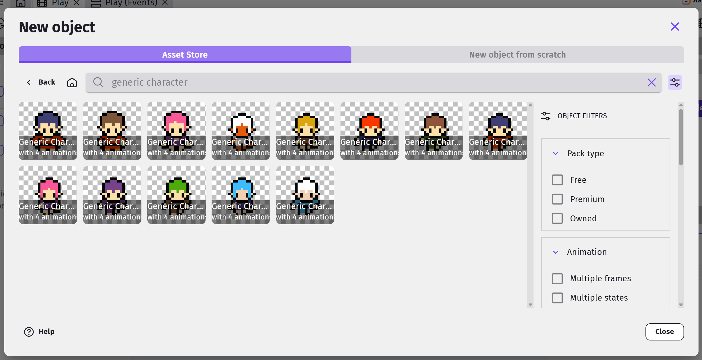
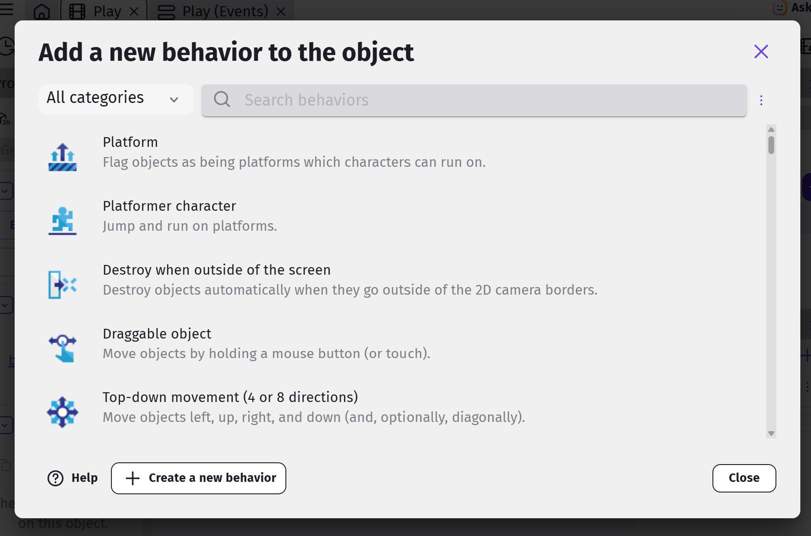
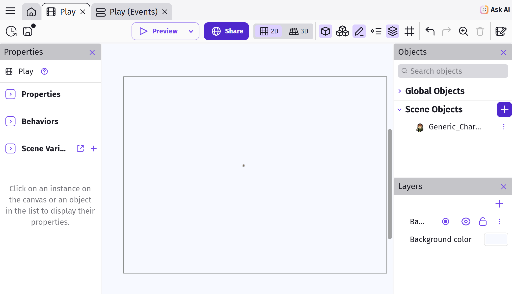
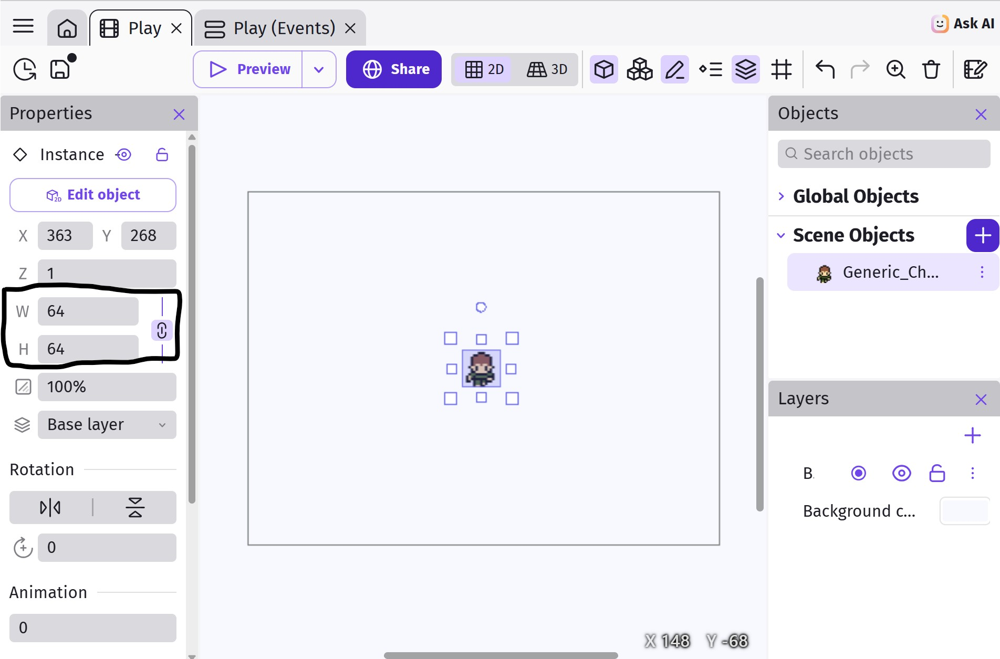

# Player

Open up the **Play** scene editor and click on **+ Add object** under the Scene Objects panel.

Then choose the Asset Store tab and search for one of the **Generic Character 3** sprite and add either to the game.  In fact, any "Generic Character" with the 4 basic top-down animations will do for this tutorial.

Most of the character assets in the store are meant for platformer games, and won't be suitable as they lack an up / down animation.

Make sure to click **Add to Scene** before closing the Add Object window.

NOTE: You can find many free assets online from sites such as [OpenGameArt](https://opengameart.org/), but adding them to the game is a more advanced topic we don't cover.  If you feel inclined and have the time in this session, do feel free to explore this option on your own (lots of youtube tutorials to follow) or with assistance from a mentor.

## Adding Behaviors

Our game will be using a top-down orientation, so just as before, we'll add the **Top-down movement** behavior.

Double click on the player object, switch to the **Behaviors** tab, and click **Add a Behavior to the object**.

The **Top-down movement** behavior is already pre-installed by default, so you can just click to add it.
This behavior allows us to move the player using the arrow keys, and after adding it, you can tune the parameters (eg. speed and acceleration).
For now, just make sure the **Rotate object** option is disabled, and leave the rest of the settings alone (...or mess around with it. Experimentation is cool.).

## Adding an Instance

Drag the player character on to the scene.
It looks a little small doesn't it!
That's because this images is only 16 pixels tall and 16 pixels wide.
Fortunately, we can resize it...

Make sure the Properties panel is visible on the left, then select the character instance in the scene editor window - you may need to drag a window around it as it is too small to click on...  

The Properties panel should now be set to focus on the chosen instance and you can set both the **Width** and **Height** to **64**, then position the player at the center of the scene.

