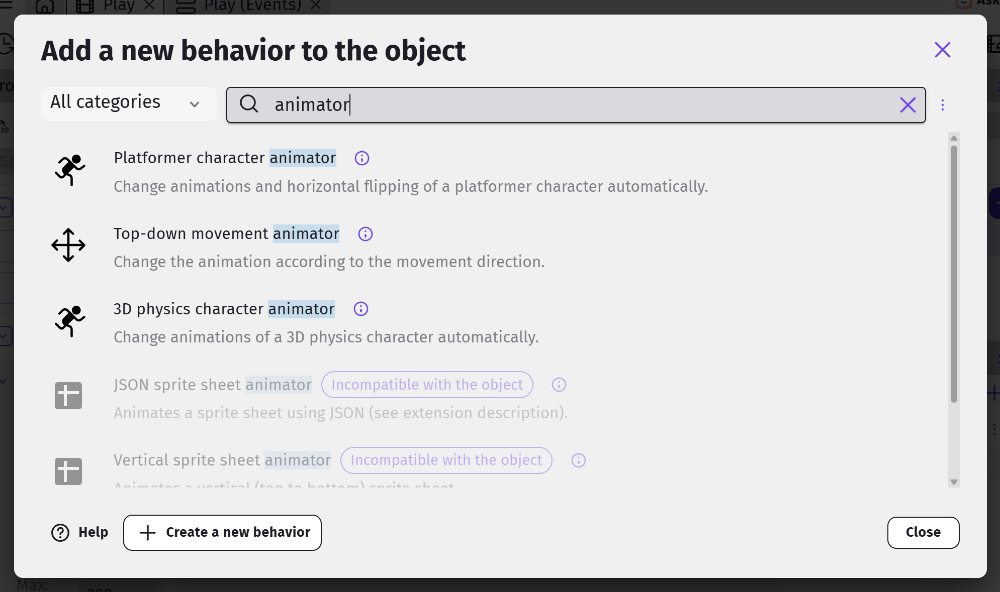
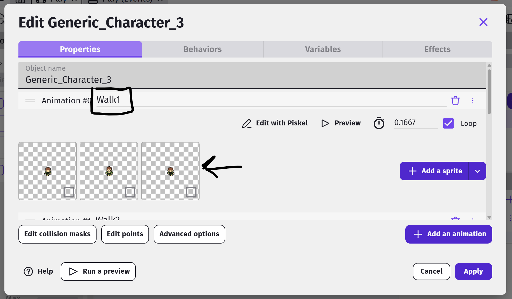
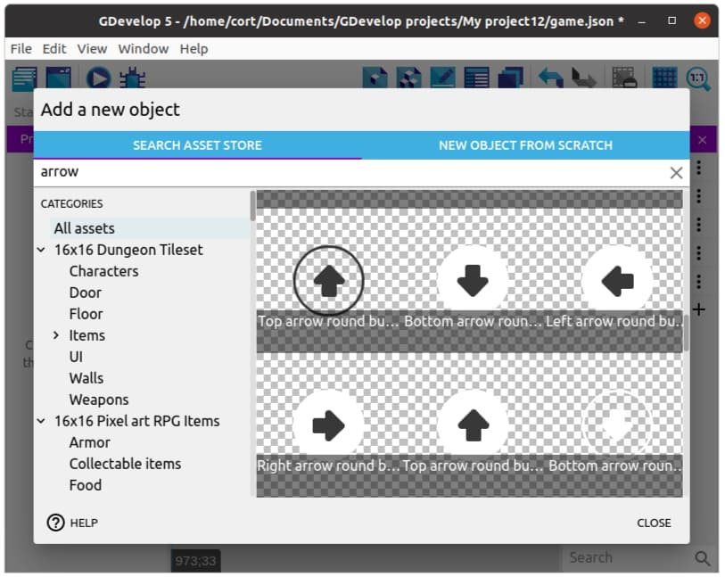
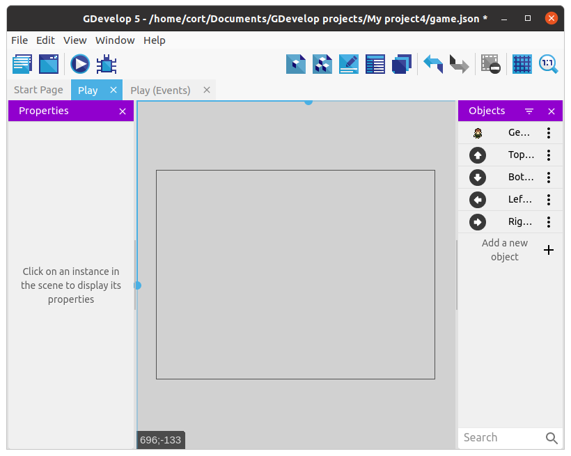
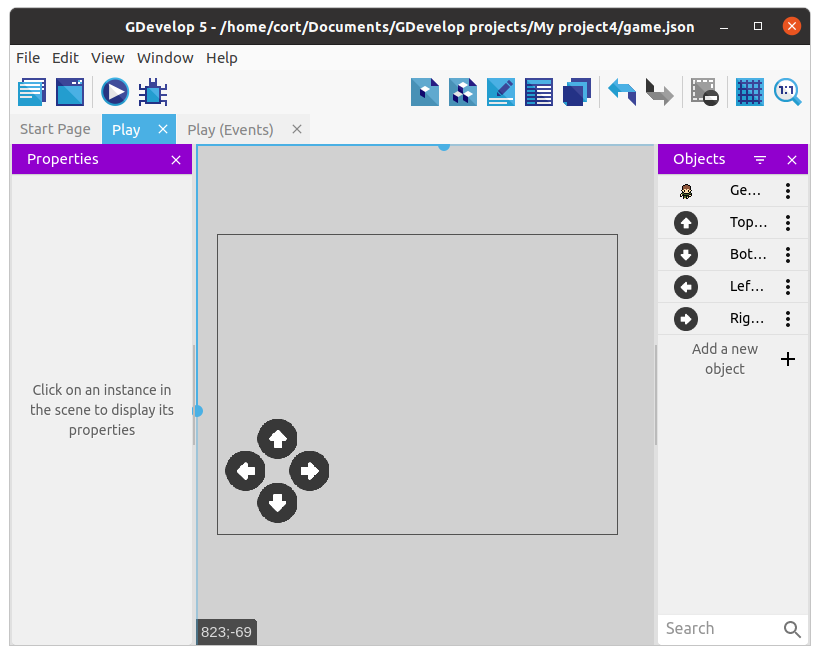
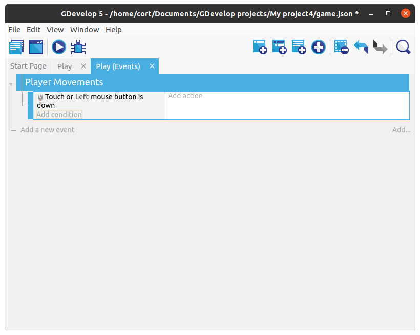
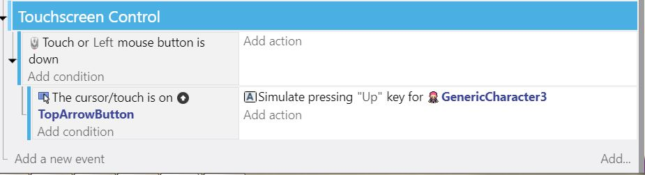
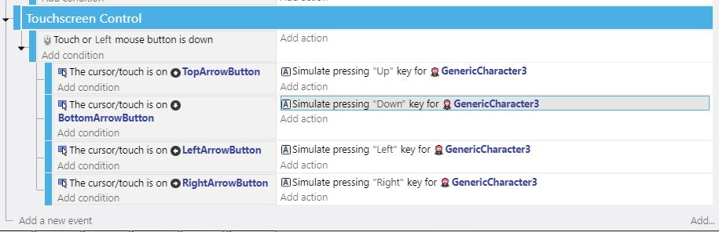

Player Controls
---

The **Top-down movement** behavior allows you to control the player using the arrow keys on the keyboard.

Press the **Preview** button and test moving the character around the screen with the arrow keys.

It moves, but it needs some animation to make it more dynamic.

if you're on a tablet, you might not have a keyboard!
To solve that, we'll add virtual keys to the screen in the optional section at the end of this page.

## Animation

We could follow the example events for controlling animation in Dodge the Creep, but there's a simple Behavior shortcut we can use to be more efficient with our time.

Open the Behaviors tab of the Generic Character player object and search for **"Animator"**.

Click on the **Top-Down movement animator** behavior and add it to your player.

You will then need to rename your player's animations in the object Properties tab.  Double Click the player object and stay on the Properties tab.  Scroll down to each animation and change their names as follows:

**Right -> Walk0 
Down -> Walk1 
Left -> Walk2 
Up -> Walk3 **

The order they appear in the Properties tab, or their animation number is not important.  Only the exact character naming that is associated. And capitalization of **W**alk is a must.

 
 
 

# (OPTIONAL) Touchscreen Control

## Control Buttons

Add a new object and select an up arrow. You can use whichever one you prefer.

Continue adding arrows until you have one in each direction.

Drag one instance of each arrow into the scene, and for each arrow...

1. Change the size to something appropriate (...if required).
2. Position it like in the following image.

Create a **Group Event** for Touchscreen Control.

Next, select the group event and add a new sub-event.
For this first sub-event, we'll be adding the **Mouse button pressed or touch held** condition.
Under **Button to check** select the **Left (primary)** button, then click **Ok**.

Your events tab should now look like this...

This first event will detect when you touch the screen, but it can't tell which button was touched.
To do that, we'll add a sub-event under it to detect the buttons.
Select the **Touch or mouse down** event, and add another sub-event.

For the conditions, select the **Up** arrow, then select **cursor/touch is on an object** condition.
And for the action, select the player object, then select the **Simulate Control of Top-Down Movement ("Up")** action.

The animation will be taken care of by our other actions for what to do in case of different controls simulated.

Your events tab should now look like this...

## Add the rest

Repeat the steps, adding a sub-event for each direction.
When you're done, your events tab should look like this...

