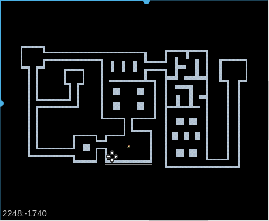
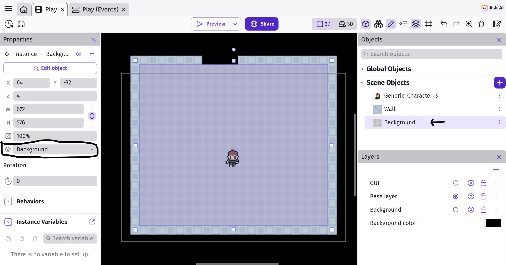
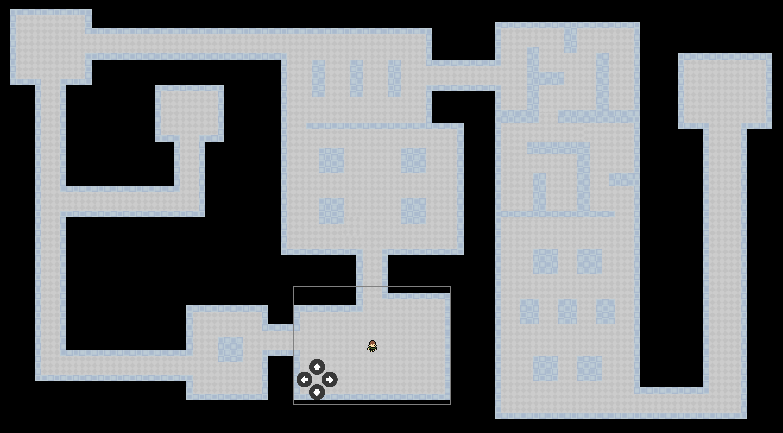
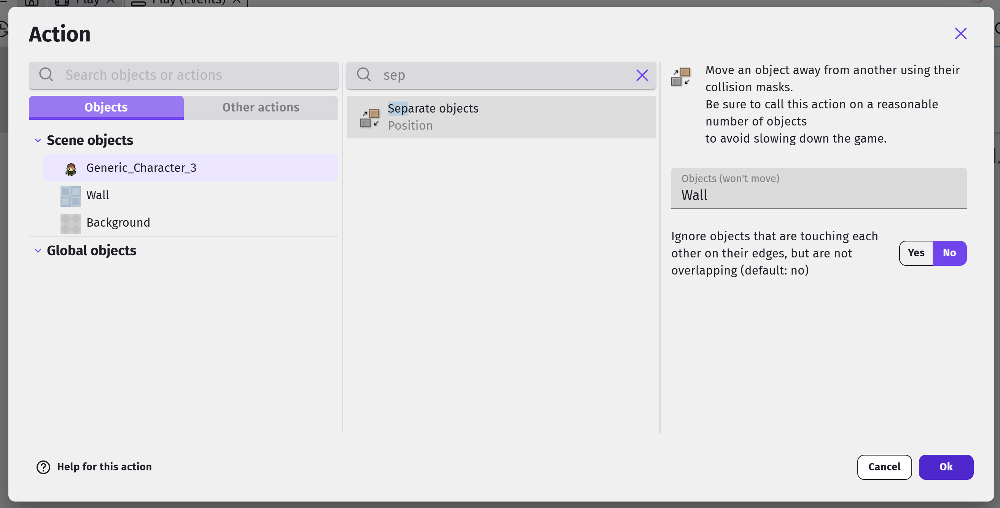
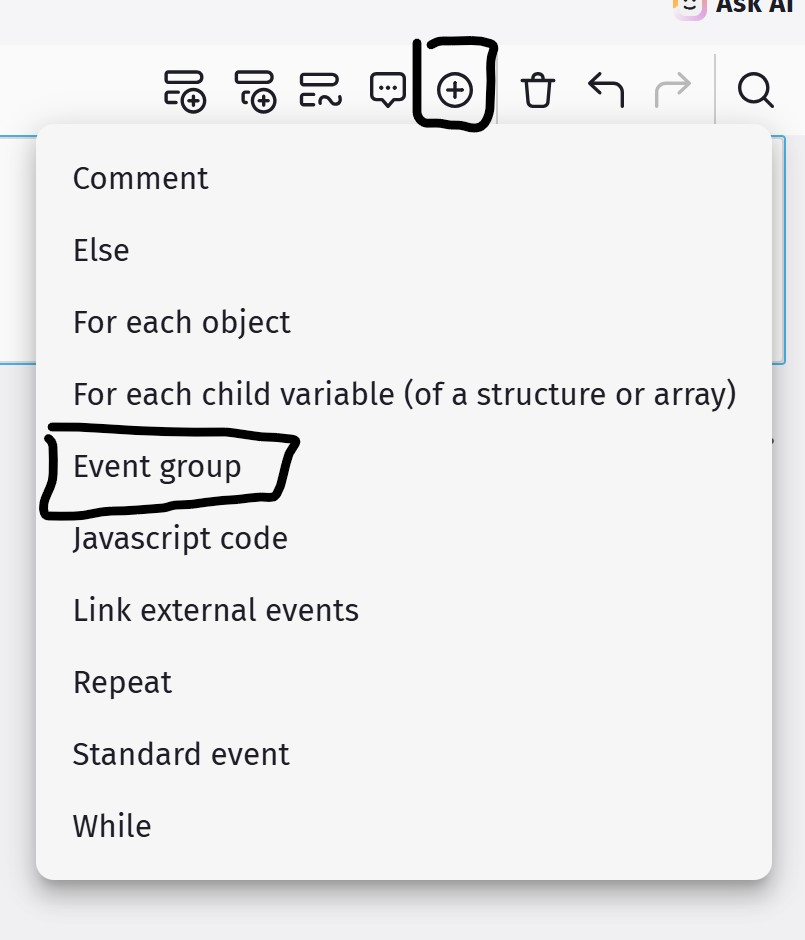
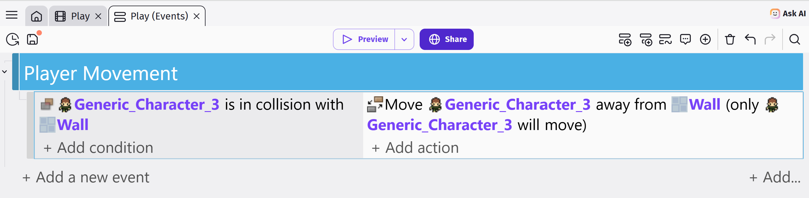
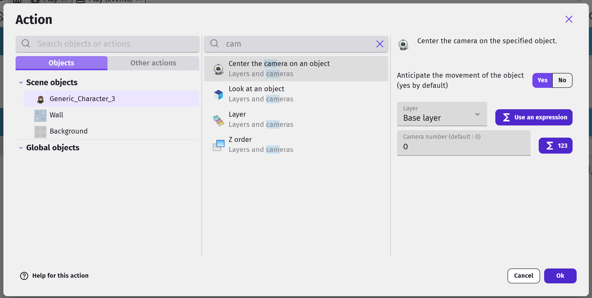
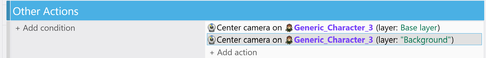

# Game World

To make it easy for us to design the world, let's rename **Blue Background** to **Wall** (...not essential, but it makes things clearer), then drag it on to the scene.
Resize it and use it to build the first wall in the scene.
Repeat...

<video autoplay muted loop>
  <source src="images/assembleWalls.mp4" width="200" type="video/mp4">
</video>

...until you have a huge maze...

*Grid temporarily turned off for clarity*

You do not need to copy this maze, make your own awesome dungeon.

Next, rename **Gray Background** to **Ground**, and drag it on to the scene.
Change its layer to **Background**, and position it within the interior areas of the maze like this...

Repeat until all the interior areas of the maze are filled with ground. 

Changing the layer for all the ground sprites can be quite a pain.
One shortcut is to change the layer for the first ground sprite, then **duplicate it**.

## Wall Collision

If you test the game now, your player will be able to move right through the walls.
To prevent that, we'll need to add a new event.

Select the **Player Movement** group event and add a new sub-event.

For the condition, choose the player, then **Collision**, and set the object to **Wall**.
For the action, choose the player, then **Separate objects**, and set the object to **Wall**.

## Group Events

In **Dodge the Creep**, we only used **Standard Events** and **Sub-Events**.
That works fine, but as we have more events, things starts to get messy.

**Group Events** are used to organize and structure our events.
By themselves, they have a title, but otherwise do nothing at all.

**Group Events** are only useful when we add sub-events to them.
This lets the group event act like a header for a group of events.
For example, we can create a group event with the title "Enemies" and place all the events related to the enemies under this group.

Let's start by creating a group event, and naming it "Player".  

Put the wall collision event in there...

## Camera

Great!
Now you can't move through walls, but you can't go very far either without leaving the screen.

To keep our player on screen, we need to make the camera follow the player as they move.
Select the **Player Movement** group event again and add another new sub-event.

We don't need a condition for this, as we want the camera to always follow the player.
For the actions, select player object, then search for **Center the camera on an object**.
For the layer, you can leave it the Base Layer, and for camera type "0". 

Now, add a second action below the first.
Make the second action the same as the first, but this time, set the layer to **"Background"**.

Go ahead and test out your game.
You should be able to move around the world without going through walls.