# Princess NPC

Now let's add a second NPC; the princess.
I'm using the **Elf Female** sprite, but as always, you can choose what you want.

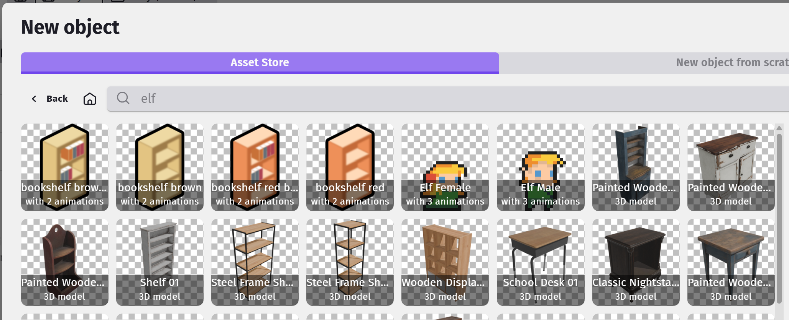

Rename the object to **Princess**, drag an instance of her on to the scene, resize her, and set an appropriate animation.
For me, I'm placing her in a distant room.

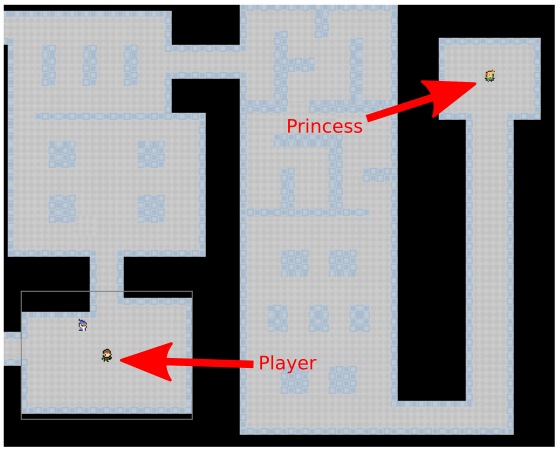

## Door

It'll be too easy if we can just walk straight up to the princess, so let's put her behind a locked door.
I'm using this sprite...

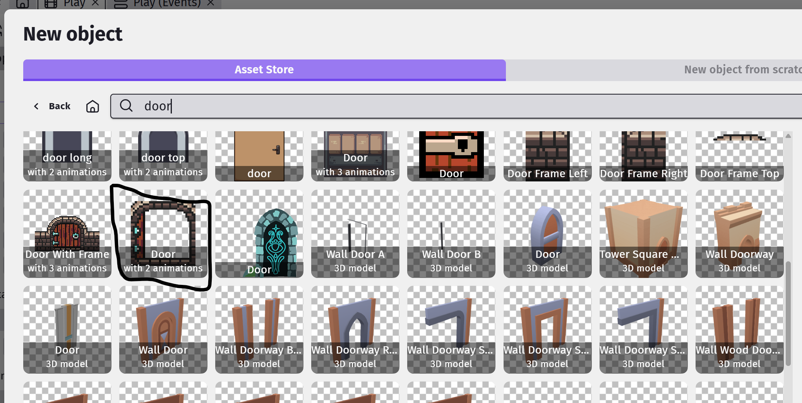

Add it to your game, drag an instance on scene, resize, then position the door somewhere suitable.

Also, the door should start as locked, so you can flip the order of the animations in th eProperties tab of the door, so that it starts out Locked/Closed.

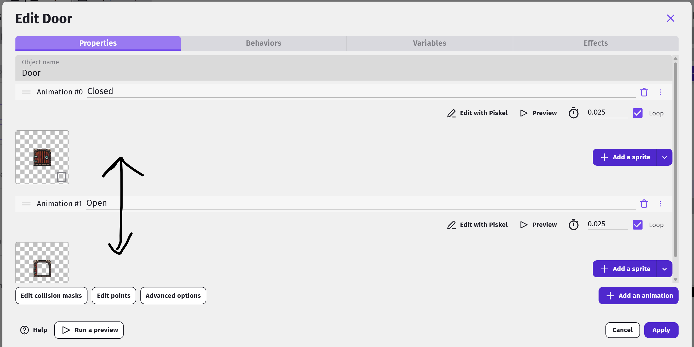

## Key

To unlock the door, we'll need a key...

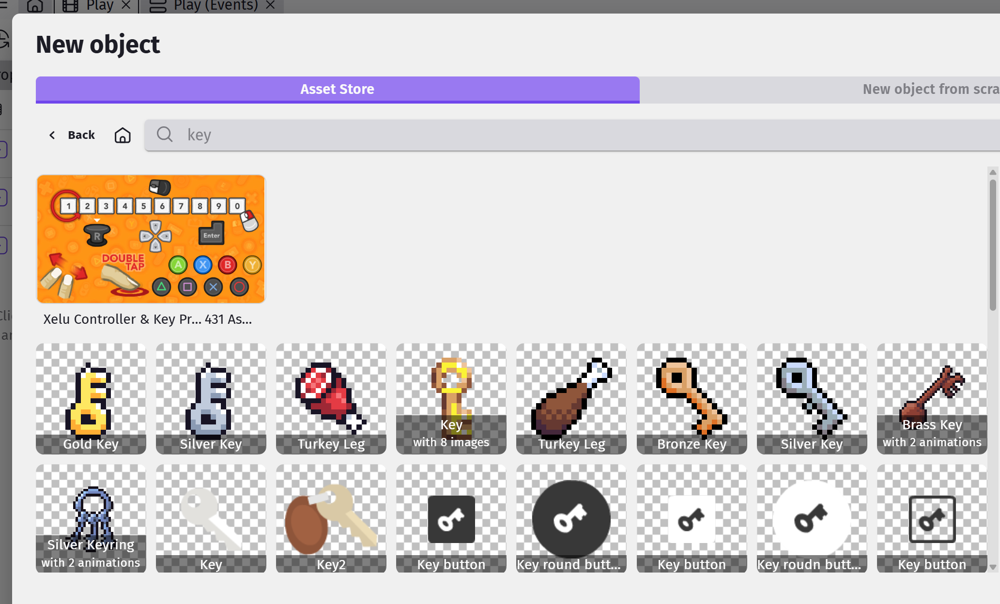

Choose a suitable key, add it to your game, and drag an instance on scene.

## Events for Key

This is what we need the key to do...

1. When touched, it should disappear.
2. The game should remember that the player has picked up the key.

Start by creating a group event named **Key**, then add a sub-event to it.
For the condition, select the player, **Collision**, then choose the **Key**.
For the action, choose the **Key**, then **Delete object**.

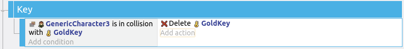

To remember that the player has picked up the key, we'll need to set the value of a **Variable**.

Add another action to the previous event, select Character object, then search for **Change object variable value**.

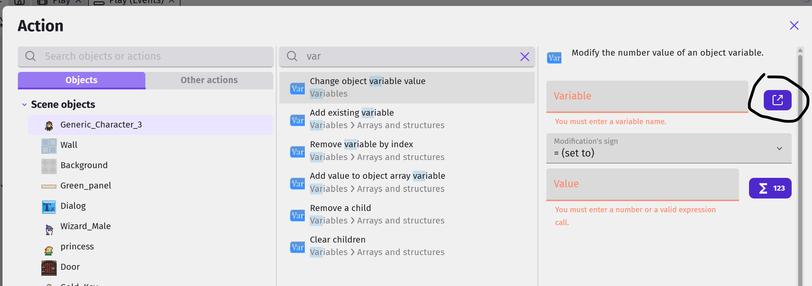

Click on the **edit variable** button and add a new variable.
Give the variable the name **hasKey**, set it to a **Boolean**, and leave it to start with the value **False**.

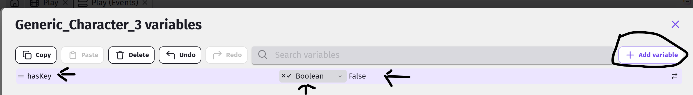

In the actual action set the hasKey variable to True - this is the action for picking up the key.

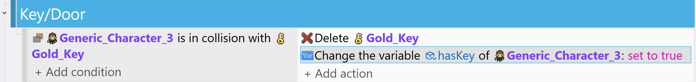

## Events for Door

This is what we need the door to do when it is touched...

1. If the **hasKey** variable is **True**, it should change to the **Open** animation.
2. If the **hasKey** variable is **False**, it should move the player away from the door.

Start by creating a group event named **Door/Key**, then add a sub-event to it.
For the condition, select the player, **Collision**, then choose the **Door**.
Don't set any actions for this, instead, add two more sub-events to this sub-event.

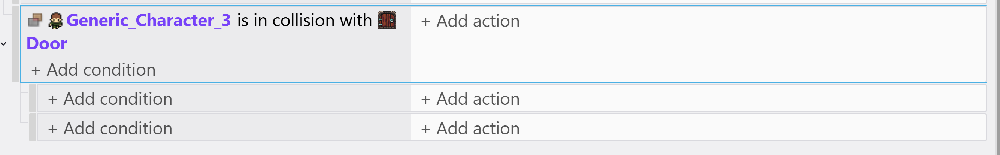

In the first sub-event, set the condition to **Character -> Object variable value**.
Choose the variable **hasKey**, set to **= (equal to)**, and value to **True**.

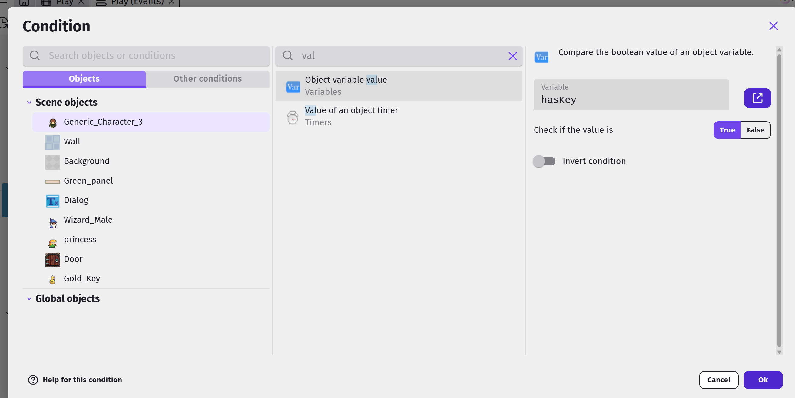

For the action, choose the **Door**, select **Animation (by name)**, then **= (set to)** a value of **Open**.

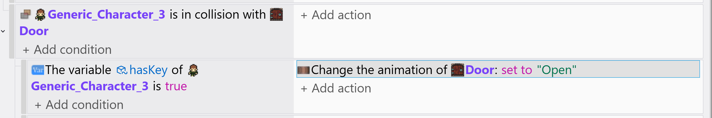

For the second sub-event, use the same condition as the first, but set it to check for **False**.
For the action, choose the player, select **Separate objects**, then choose the **Door**.

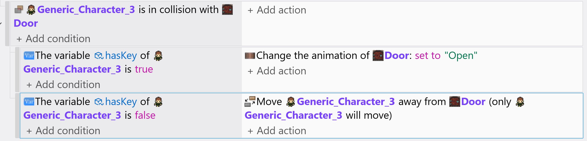

## Test Environment

You can **test** that your character can pick the Key, and that the door will be locked until he does so, and ince he does it opens and can pass through!

To speed up testing you can temporarily move your character and the key near the door... After you are satisfied, you can move them back to their original locations.  Remember this technique.
